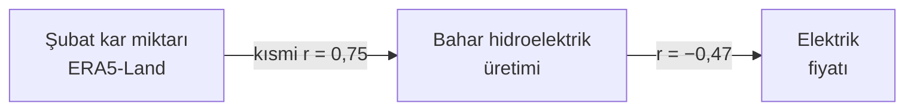
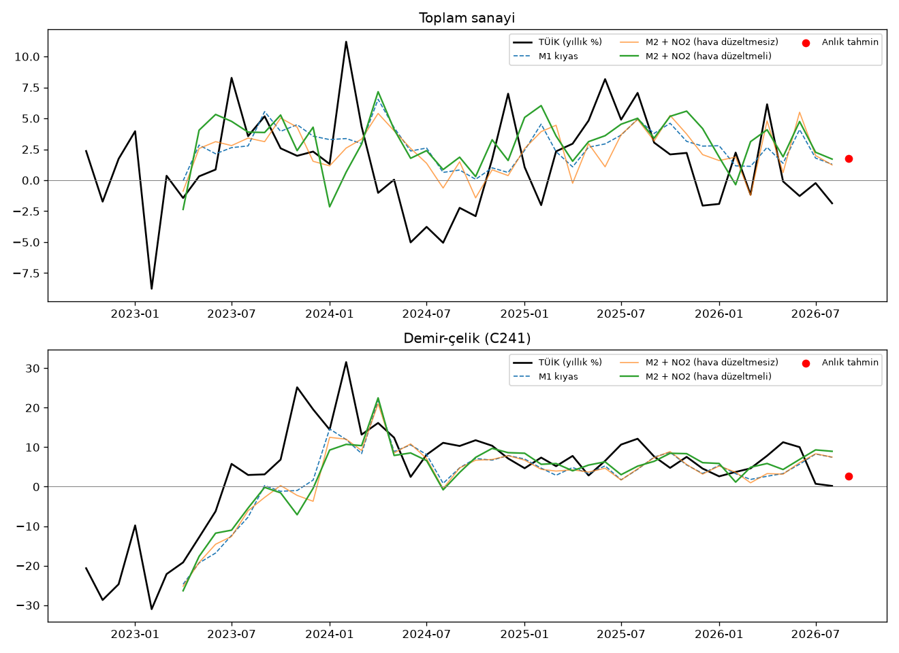

# Türkiye Uydu Sinyalleri

## Özet

Bu çalışmada uydu görüntüleri, iklim yeniden analiz verisi ve elektrik piyasası verisinden Türkiye ekonomisi ve Borsa İstanbul şirketleri için öncü göstergeler üreten bir veri hattı geliştirilmiştir. Çalışmanın temel sorusu, baraj doluluğu, sanayi tesislerinin ısısı ya da hava kirliliği gibi alternatif veri kaynakları kullanılarak türetilen verilerin, resmi istatistikler ve finansal raporlar açıklanmadan önce finansal içgörü üretip üretemeyeceğidir. Toplam 21 hipotez sınanmış olup kar miktarının hidroelektrik üretimini, hidroelektrik üretiminin elektrik fiyatını öngördüğü bir zincir kurulmuş; şirketlerin döviz pozisyonundan türetilen bir sinyalin ise finansal rapor öncesi hisse getirisini öngördüğü bulunmuştur.

## Veri

| Veri | Ölçülen büyüklük | Hedef değişken |
|---|---|---|
| Sentinel-2 | İstanbul ve Fırat barajlarının su yüzey alanı | Su arzı, hidroelektrik üretimi |
| Sentinel-2 ve Landsat 8/9 (termal) | Erdemir, İsdemir ve Kardemir tesislerinin ısı izi | Çelik üretimi |
| Sentinel-2 | TRALT altın madeni sahalarında çıplak alan | Altın üretimi |
| Sentinel-5P | Sanayi bölgelerinde NO₂ yoğunluğu | Sanayi üretimi |
| VIIRS | İl bazında gece ışığı yoğunluğu | Bölgesel büyüme |
| ERA5-Land | Kar su eşdeğeri, yağış, su girdisi | Hidroelektrik üretimi |
| EPİAŞ | Santral bazında saatlik üretim ve piyasa takas fiyatı | Elektrik şirketlerinin geliri |
| İş Yatırım, KAP, TÜİK, UN Comtrade | Finansal tablolar, döviz pozisyonu, sektör fiyat endeksleri, ihracat | Şirketlerin kâr sürprizi |

Uydu verileri Google Earth Engine ve STAC katalogları üzerinden, elektrik piyasası verisi EPİAŞ Şeffaflık Platformu API'si üzerinden otomatik olarak toplanmaktadır. Yalnızca çelik tesisleri için 4.000'i aşkın Landsat termal sahnesi işlenmiştir. Şirket bilançolarına yönelik çalışmalar 2016–2022 döneminde 121 şirketi kapsamaktadır.

## Yöntem

Her hipotez iki aşamada değerlendirilmiştir. İlk aşamada ölçümün hedeflenen fiziksel ya da muhasebe büyüklüğünü izleyip izlemediği, ikinci aşamada ise bu bilginin hisse getirisini, kamuya açık bilgiye ek olarak öngörüp öngörmediği sınanmıştır. Uydu verisi toplanmadan önce, altta yatan büyüklüğün kusursuz bilinmesi durumunda dahi getiri elde edilip edilemeyeceği sorgulanmıştır (mükemmel bilgi testi). Karar kuralları, eşikler ve sonuçlar [tarihli test kaydında](docs/ARASTIRMA_PLANI.md) yer almaktadır. Yaklaşık 53 karar istatistiği hesaplandığından, yeni bir bulgu için p < 0,005 ya da ileriye dönük doğrulama hedeflenmiştir.

## Bulgular

Elektrik piyasasında, uydu ve iklim verisinden elektrik fiyatına uzanan bir öncü gösterge zinciri kurulmuştur:



Şubat ayı kar miktarı (kar su eşdeğeri), kış üretimi kontrol edildiğinde dahi Mart–Temmuz hidroelektrik üretimini öngörmüştür (kısmi korelasyon 0,75). Hidroelektrik üretiminin yüksek olduğu çeyreklerde dolar bazlı elektrik fiyatı düşmüştür (r = −0,47). Gaz maliyeti ve kur kontrollerini içeren araç değişkenli regresyon (2SLS) tahminine göre hava koşullarından kaynaklanan %10'luk üretim artışı elektrik fiyatını yaklaşık %6 düşürmektedir.

Başlıca sonuçlar aşağıda özetlenmiştir. Değerler korelasyon katsayısı ya da bilgi katsayısıdır (IC: şirketlerin sinyale göre sıralaması ile sonraki dönem değerine göre sıralaması arasındaki korelasyon).

| Hipotez | Sonuç |
|---|---|
| Şubat kar miktarı → bahar hidroelektrik üretimi | Kısmi r = 0,75 |
| Hidroelektrik üretimi → elektrik fiyatı | r = −0,47; %10 üretim artışı ≈ %6 fiyat düşüşü |
| Sentinel-2 baraj alanı → İSKİ doluluk oranı (Ömerli) | r ≈ 0,90 |
| Santral bazında üretim × saatlik fiyat → şirketlerin raporladığı hidroelektrik geliri | r = 0,63; dört şirketin dördünde pozitif |
| Döviz pozisyonu × kur değişimi → kâr sürprizi | IC = 0,25 (t = 6,7) |
| Döviz pozisyonu × kur değişimi → çeyrek sonu sonrası hisse getirisi | IC = 0,08 (t = 3,8, momentum kontrolü sonrası) |
| Sektör üretici fiyatları → brüt marj sürprizi | IC = 0,15 (t = 5,9) |
| Şirkete özgü GTİP ihracatı → satış sürprizi | r = 0,42; dört şirketin dördünde pozitif |

En güçlü piyasa sinyali döviz pozisyonuna dayanmaktadır. Şirketin net döviz pozisyonu ile çeyrek içindeki kur değişiminden kâr sürprizi tahmin edilmiş; bu sinyal çeyrek sonu ile finansal raporun açıklanması arasındaki hisse getirisini öngörmüş ve fiyat momentumu kontrol edildikten sonra da anlamlı kalmıştır.



*Sentinel-5P NO₂ ölçümleri ve hava koşullarıyla kurulan sanayi üretimi anlık tahmin modeli.*

## Uygulama

Kod Python ile yazılmıştır (pandas, NumPy, SciPy, statsmodels). Uydu görüntüsü işleme adımları su maskesi, sıcak piksel tespiti ve bulut filtrelemeyi kapsamaktadır. Ekonometrik yöntemler arasında araç değişkenli regresyon, olay çalışması ve bilgi katsayısı analizi yer almaktadır.

```bash
pip install -r requirements.txt
cp .env.example .env                        # Earth Engine projesi, EPİAŞ hesabı, EVDS anahtarı
python src/prototypes/demo_sentetik.py      # sentetik veriyle çevrimdışı deneme
python src/collect/hepsi.py                 # veri toplama
```

Tüm test sonuçları, yeniden üretme adımları ve veri kaynakları [`docs/AYRINTILAR.md`](docs/AYRINTILAR.md) dosyasında yer almaktadır.

## Sınırlılıklar

- **Hisse getirisine yansıma:** Fiziksel ilişkilerin çoğu hisse getirisine yansımamıştır. Kar sinyali hidroelektrik hisselerinin getirisiyle ilişkili bulunmamıştır (r = 0,09). Santral gelir modelinde, ölçüm aşaması başarılı olsa da bilanço günü getirisiyle ilişki zayıftır (Spearman 0,07). Sektör fiyatı ve ihracat sinyalleri de bilanço günü getirisini öngörmemiştir.
- **Döviz pozisyonu sinyali:** Sinyal, kur maruziyetinin kendisinden ayrıştırılamamıştır. Bu nedenle bulgu olarak değil, ileriye dönük sınanacak bir aday olarak kaydedilmiştir.
- **Santral gelir modeli:** Korelasyon büyük ölçüde AYDEM'in 2022'deki fiyat artışı çeyreklerine dayanmaktadır; bu çeyrekler çıkarıldığında r ≈ 0,08'e düşmektedir.
- **Ömerli doğrulaması:** Tek barajda 38 bulutsuz güne dayanan bir ön sonuçtur; 2017'den itibaren planlanan tam doğrulama yapılmamıştır.
- **Ölçüm aşamasında kalan hipotezler:** Fırat barajları su alanı (r = 0,08), çelik tesisi ısı izi, maden sahası çıplak alanı (Spearman 0,20), gece ışıkları (r = 0,01) ve bahar donu hipotezleri ölçüm aşamasını geçememiştir. Gündüz kızılötesi sensörleri çelik fırınlarının proses ısısını ayırt edememiş; İsdemir'in Şubat 2023 depremleri sonrasında durduğu dönemde dahi ölçüm yüksek kalmıştır.
- **NO₂ modeli:** NO₂ ölçümleri, son açıklanan resmi veriye göre tahmin performansını belirgin biçimde iyileştirmemiştir.
- **Genel:** Birçok testte örneklem küçüktür (n = 9–40). Yaklaşık 53 karar istatistiği hesaplandığından sonuçlar çoklu test bağlamında değerlendirilmelidir. Bilanço çalışmalarının evreni bugünkü BIST Yıldız Pazar şirketleridir (hayatta kalma yanlılığı). Tarihli kayıt kişisel olarak tutulmuştur.

*Kodlama ve veri toplamada Claude Code yardımcı araç olarak kullanılmıştır. Bu çalışma yatırım tavsiyesi niteliği taşımaz. Kod MIT lisansı ile paylaşılmaktadır; türetilmiş veriler kaynaklarının lisans koşullarına tabidir. Contains modified Copernicus Sentinel data 2017–2026 and modified Copernicus Climate Change Service information 2001–2026.*
