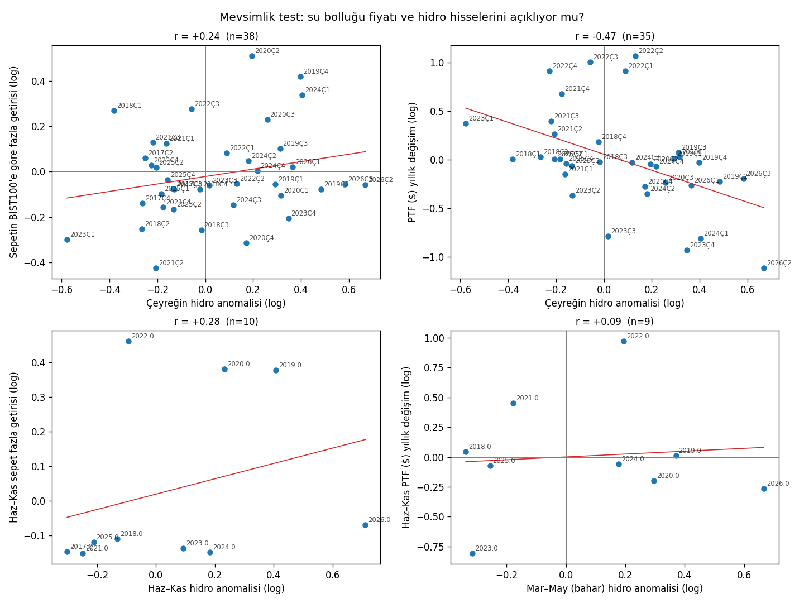

# Ayrıntılar

Çıkış noktası, Cushing petrol tanklarını ücretsiz uydu görüntüsüyle ölçmeye çalışan [bir YouTube videosu](https://www.youtube.com/watch?v=VJm9BBJwMDY) oldu; kodda ve grafiklerde geçen "video" ifadeleri buna atıftır.

README'nin kısa tuttuğu her şey: araştırma disiplini, tüm test sonuçları, ne işe yaramadığı, sınırlar, yeniden üretme ve veri kaynakları (atıf ve lisans koşulları dahil).

## Araştırma disiplini

- Önce kural yazıldı. Her testin verisi, ölçüsü, eşiği ve kararı, sonuç hesaplanmadan tarihli bir kayda yazıldı: [`docs/ARASTIRMA_PLANI.md`](../docs/ARASTIRMA_PLANI.md). Sonuçlar kuralın altına eklendi. Kural değişmesi gerektiğinde eski kural düzeltilmedi; değişiklik yeni test numarası aldı ve iki sürüm de raporlandı (ör. T-IV1'den sonra T-IV2).
- Kanıtın sınırı açıkça söyleniyor. Tarih damgaları yerel bir dosyaya elle yazıldı. Bu repo araştırma bittikten sonra oluşturuldu; commit tarihleri ön kaydın kanıtı değildir. Kanıt, plan dosyasındaki tarihli kayıtlardır; iyi niyetle tutulmuş bir kayda ne kadar güveniliyorsa o kadar.
- Mükemmel bilgi kapısı. Bir işlem fikri için uydu verisi toplamadan önce şu soruldu: altta yatan büyüklüğü kusursuz bilseydik para kazanır mıydık? Cevap hayırsa iş orada durdu.
- İki aşamalı kapı. Önce ölçüm kapısı: sinyal fiziksel ya da muhasebe büyüklüğünü izliyor mu? Sonra piyasa kapısı: maliyetten sonra ve zaten kamuya açık olana göre getiriyi öngörüyor mu?
- Kıyas, "zaten bilinen"dir. Kıyas son açıklanan resmi veri, son raporlanan çeyrek ya da EPİAŞ'ın yayımladığı veridir; hiçbir zaman sıfır değildir.
- Çoklu test bilinci. Kayıtta bir test sayacı tutuldu. Kayıttan önce yaklaşık 26 keşif testi yapılmıştı; sonuna kadar toplam yaklaşık 53 karar istatistiğine ulaşıldı. Bu sayı göz önüne alınarak yeni bir "bulgu" için hedef p < 0,005 ya da ileriye dönük doğrulama olarak konuldu. Sonradan yapılan kontroller *kayıt dışı* diye işaretlendi ve kararı değiştirmedi. İyi görünen ikincil ölçüler sonradan seçilmedi. Örneğin MODIS kar örtüsü sepetle +0,66 çıktı, ama karar ölçütü olmadığı için kullanılmadı.
- Maliyet. Her pozisyon değişikliğinde %0,2. Verideki hayatta kalan yanlılığı ve ileriye bakma sorunları gizlenmedi, kayıtta belgelendi.

## Sonuçlar

Kaynak kısaltmaları: **S2** Sentinel-2 · **S5P** Sentinel-5P · **L8/9** Landsat · **VIIRS** gece ışıkları · **ERA5** ERA5-Land yeniden analizi (görüntü değil) · **EPİAŞ** elektrik piyasası şeffaflık verisi · **Fin** İş Yatırım mali tabloları, KAP yayın tarihleri ve fiyatlar.

### Keşif çalışmaları (test kaydı açılmadan önce; önceden kayıtlı değil)

| Test | Soru | Kaynak | Sonuç | Okuma |
|---|---|---|---|---|
| NO₂ anlık tahmini | NO₂, sanayi üretimi tahminini son açıklanan endekse göre iyileştiriyor mu? | S5P | Örneklem dışı RMSE iyileşmesi: toplam sanayi +%1,3 (hava düzeltmesiz), −%9,5 (hava düzeltmeli, yani daha kötü); demir-çelik −%4,5 / −%5,7 | Kazanç yok |
| Baraj alanı | Su yüzey alanı İSKİ doluluğunu izliyor mu? | S2 | Ömerli'de korelasyon ≈ 0,90 (38 bulutsuz gün, 2025–26; önceki iç rapor, çıktısı repoda yok) | Ölçüm çalışıyor görünüyor; tam doğrulama yapılmadı |
| Haftalık hidro, mükemmel bilgi | Gelecek haftanın hidro üretimini bilmek, hidro hisselerinde rastgele zamanlamayı yener mi? | EPİAŞ | Mükemmel bilgiyle bile 6 hisseden yalnız AKFYE maliyet sonrası kaydırılmış kopyaların %95'ine ulaştı (tam eşikte); ENTRA ters yönde | Ticari değeri yok |
| Mevsimlik | Çeyreğin hidro anomalisi ~ PTF ($) yıllık değişim | EPİAŞ | r = −0,47; %90 aralık [−0,65, −0,27]; n = 35 | Sağlam ilişki |
| Mevsimlik | Önceki çeyreğin hidrosu → hidro sepetinin fazla getirisi | EPİAŞ | r = +0,35; %90 aralık [+0,12, +0,55]; strateji kaydırılmış kopyaların %97'si | Kırılgan; tek strateji, küçük n; tesadüf olabilir |

### Önceden kayıtlı testler: uydu, hava ve elektrik

| Test | Hipotez | Kaynak | Karar ölçütü | Sonuç | Karar |
|---|---|---|---|---|---|
| T-A1 | Kış hidrosunun ötesinde kara yer var mı? (mükemmel bilgi kapısı) | EPİAŞ | r²(kış → bahar) < 0,70 **ve** artık ~ sepet ≥ +0,30 (ya da ~ PTF ≤ −0,30) | r² 0,42; sepet +0,34 | Geçti (kıl payı) |
| T-A2 | Şubat karı Mart–Temmuz hidrosunu **ve** hidro sepetini öngörür | ERA5 | kısmi r ≥ 0,50 **ve** artık ~ sepet ≥ 0,30 | 0,75 **/ 0,09** | **Kaldı** (fiziksel kısım geçti) |
| T-F1 | Fırat barajlarının alan değişimi sonraki 3 ayın hidrosunu öngörür | S2 | kısmi r ≥ 0,30 | 0,08 (n = 107) | Kaldı |
| T-C1 | Sıcak piksel endeksi çelik üretimini izler | S2 | iki tesiste r ≥ 0,50 **ve** deprem duruşunda 2022 düzeyinin < %20'si | 0,09 / 0,07; %79 | Kaldı (yöntem) |
| T-M1 | TRALT liç sahalarında çıplak alan üretimi öngörür | S2 | Spearman ≥ 0,40 | 0,20 (n = 20) | Kaldı |
| T-L1 | Mükemmel hidro bilgisi → elektrik tüketen çelik hisseleri | EPİAŞ | beklenen yönde \|r\| ≥ 0,30 **ve** kaydırılmış kopyaların ≥ %95'i | +0,07; %51 | Kaldı |
| T-L2 | Aynısı → termik santraller (beklenen yön negatif) | EPİAŞ | aynı | +0,08 (ters yön); %35 | Kaldı |
| T-G1 | Bahar donu → meyvenin göreli TÜFE'si | ERA5 (Open-Meteo) | r ≥ +0,45 ve bir-yıl-çıkar en düşük ≥ +0,25 | −0,36 | Kaldı |
| T-G2 | Bahar donu → meyve üretimi | ERA5 (Open-Meteo) | r ≤ −0,45 ve bir-yıl-çıkar en yüksek ≤ −0,25 | −0,15 | Kaldı |
| T-N2 | Kıyas: günlük elektrik üretimi sanayi üretimi tahminini iyileştirir | EPİAŞ | RMSE iyileşmesi ≥ %10 (2023-04 → 2026-08) | −%101 | Kaldı |
| T-C2 | Landsat termal ΔT çelik üretimini izler (kapı 1) → bilanço günü getirisi (kapı 2) | L8/9 | kapı 1: r ≥ 0,40 | 0,05; kapı 2 (yalnız rapor) 0,08 | Kaldı |
| T-E1 | Santral üretimi × saatlik PTF, hidro şirketlerinin raporlanan gelirini izler (kapı 1) → bilanço günü getirisi (kapı 2) | EPİAŞ + Fin | kapı 1: r ≥ 0,60 ve 4 şirketin ≥ 3'ünde pozitif; kapı 2: Spearman ≥ 0,25 | kapı 1: 0,63, 4/4 (**AYDEM 2022 hariç 0,08**); kapı 2: 0,07 | Kapı 1 kâğıt üzerinde geçti, kırılgan; **kapı 2 kaldı** |
| T-I1 | Gece ışıkları büyümeyi iller arasında dağıtır | VIIRS | havuz r ≥ 0,20 ve yılların ≥ 2/3'ünde pozitif | 0,01; 10 yılın 5'i | Kaldı |
| T-IV1 | Hidronun PTF'ye nedensel etkisi (2SLS; araçlar ERA5 su girdisi) | EPİAŞ + ERA5 | tahmin; önceden yazılan beklenti β_IV < β_EKK | β_IV −0,75 (F 20,4), EKK −0,40; kontrolsüz −0,31 (t −0,8) | Beklenti tuttu; sonuç kontrollere bağlı |
| T-IV2 | T-IV1, talep ve gaz maliyeti kontrolleri düzeltilerek (T-IV1 sonucu görüldükten sonra kaydedildi) | EPİAŞ + ERA5 | tahmin | β_IV −0,63 [−0,96, −0,30], F 30,4; EKK −0,49; Hausman p 0,23 | +%10 hava kaynaklı hidro ≈ PTF −%6 |

### Bilanço sürprizi serisi (önceden kayıtlı; uydu verisi yok)

Bu seri ayrı bir soruyu sınıyor: şirketlerin çeyrek sonucunu KAP'tan önce kamuya açık veriyle tahmin etmek bilanço günü getirisi sağlar mı? Ana örneklem (T-P1): 2016Ç2–2022Ç3 mali çeyrekleri, 121 şirket; sonraki testler bunun alt kümeleri. Evren bugünkü Yıldız Pazar (hayatta kalan).

| Test | Hipotez | Kaynak | Karar ölçütü | Sonuç | Karar |
|---|---|---|---|---|---|
| T-P1 | Kâr / satış sürprizini kusursuz bilmek → bilanço günü getirisi | Fin | her ölçü için IC ≥ 0,10, t ≥ 3, Q5−Q1 ≥ %2 | kâr: IC 0,24 (t 10,3), Q5−Q1 +%3,3; satış: IC 0,07 | Kâr **geçti**; satış kaldı |
| T-P2 | Döviz pozisyonu × kur değişimi, kâr sürprizini (kapı 1) ve çeyrek sonu sonrası getiriyi (kapı 2) öngörür | Fin | kapı 1: IC ≥ 0,15 ve t ≥ 3; kapı 2: IC ≥ 0,05, t ≥ 3, Q5−Q1 ≥ %2 | 0,25; 0,081 (t 3,7), +%2,9. Bilanço günü IC −0,01 | İkisi de geçti; **kur maruziyetinden ayrıştırılamadı** |
| T-P3 | Bilanço günü tepkisini hangi kalem taşıyor? | Fin | sıralı karar kuralı | brüt kâr IC 0,17 (t 5,3); FM t 6,8 | Karar 1: hedef brüt kâr (yorum: ürün–girdi fiyat makası) |
| T-P4 | Sektör ÜFE'si brüt marjı (kapı 1) ve bilanço günü getirisini (kapı 2) öngörür | Fin + TÜİK | kapı 1: IC ≥ 0,10 ve t ≥ 3; kapı 2: IC ≥ 0,05 ve t ≥ 3 | 0,146 (t 5,9); −0,012 | Kapı 1 geçti, **kapı 2 kaldı** |
| T-P5 | Şirkete özgü GTİP ihracatı satış sürprizini (kapı 1) ve bilanço günü getirisini (kapı 2) öngörür | UN Comtrade + Fin | kapı 1: r ≥ 0,30 ve ≥ 3/4 şirket; kapı 2: Spearman ≥ 0,20 | 0,42, 4/4; 0,02 | Kapı 1 geçti, **kapı 2 kaldı** |
| T-P6 | T-P2 / T-P4'ün çeyrek sonu sinyalleri momentum kontrolünü geçiyor mu? | Fin | katsayı ≥ 0,04 ve t ≥ 2,5 | kur: 0,081 (t 3,8); sektör ÜFE: 0,056 (t 2,49) | Kur geçti → yalnızca ileriye dönük aday; ÜFE geçemedi (t 2,49) |

Kuralların tamamı, örneklem büyüklükleri, sağlamlık ve kayıt dışı kontroller [`docs/ARASTIRMA_PLANI.md`](../docs/ARASTIRMA_PLANI.md) dosyasında. Özet tablolar [`results/tables/`](../results/tables/) klasöründe.

<p align="center"></p>

*Mevsimlik test (keşif). Sağ üst: hidrosu bol çeyreklerde dolar bazlı elektrik fiyatı düşük (r = −0,47). Sol üst: hidro hisseleriyle bağ zayıf.*

## Ne işe yaramadı ve neden

- Ölçüm para demek değil. Elektrik zinciri fiziksel uçta güçlü (kar → hidro, hidro → fiyat), hisse ucunda kopuyor. Türk elektrik ve çelik hisselerinin çeyreklik getirisini spot elektrik fiyatından çok enflasyon, faiz, kur, ikili anlaşmalar ve dolar bazlı YEKDEM tarifeleri belirliyor. Sinyali doğrudan taşıyacak araç, VİOP baz yük elektrik vadelisi, işlem görmüyor. EPİAŞ toptan piyasaları yalnızca lisanslı şirketlere açık.
- Gündüz sensörleri proses ısısını göremiyor. İsdemir Şubat 2023 depreminden sonra tamamen dururken bile Sentinel-2 SWIR ve Landsat termal ölçüleri "sıcak" kaldı. Ölçülen şey fırın değil; güneşle ısınan çatı, cüruf ve beton. Bu bir yöntem başarısızlığı; asıl fikir (tesis faaliyeti → üretim) aslında sınanmış olmadı.
- Üretim çoğu zaman görünmüyor. TRALT'ın altınının çoğu yeraltı madeninden (Ovacık) geliyor. Uydudan yalnızca küçük açık ocak ve liç sahaları görünüyor.
- Gece ışıkları üretimi izlemedi. Hatay'ın ışığı 2023 depreminden sonra düşmedi. Ulusal toplam 2017'de tek adımda %28 arttı. Kayıttaki olası açıklamalar şunlar: belediyelerin LED dönüşümü, sanayi ve liman noktaları, yeniden yapım şantiyeleri. Bunlar test edilmedi.
- Kamuya açık bilgi bilanço gününde getiri vermedi. Kur ve sektör fiyatı bilgisi fiyata bilanço gününde değil, çeyrek sonu ile bilanço arasında giriyor gibi görünüyor. Kurda bu kayıtlı bir test; sektör fiyatında yalnız rapor ölçüsü ve momentum kontrolünü geçemedi. İhracat verisi satışı öngördü ama bilanço gününe tepki yok. Kayıt, piyasanın bu veriyi ya zaten kullandığını ya da satışa tepki vermediğini söylüyor; ara pencere test edilmedi. Kayıt dışı bir kontrole göre bilanço günü tepkisinin büyük kısmı şirkete özgü marj sürprizinden geliyor. Bunu öngörecek veri çoğunlukla kamuya açık değil: TÜİK tek üreticili GTİP kodlarını gizliyor ve AKSA tam da bu yüzden test edilemedi.
- Sıradan dönemleri yenmek zor. Son açıklanan sanayi üretimi rakamı, COVID gibi şok ayları dışında NO₂ ve elektrik tabanlı tahminleri geçiyor.

## Sınırlar

- Küçük örneklemler. Birçok testte n = 9–40. Tek bir yıl sonucu tersine çevirebilir; örneğin T-A1'i büyük ölçüde 2026 taşıyor.
- Ömerli doğrulaması tek barajda 38 güne dayanıyor ve önceki bir iç rapordan geliyor; o hesabın çıktısı ve korelasyon türü repoda yok. Betik, İSKİ'nin günlük serisiyle 2017'den bu yana örneklem dışı doğrulama yapabiliyor (`baraj_takip.py dogrula`; Spearman ve izotonik eğri). Ama bu adım hiç çalıştırılmadı. Bu yüzden 0,90 bir ön sonuçtur.
- Kar sonucu kara özgü değil. İkincil ölçü olan kış yağışı da aynı kısmi korelasyonu verdi (0,76'ya karşı 0,75; bkz. `results/tables/kar_testi_yeniden_calistirma.txt`). Fiziksel sinyal "su girdisi"dir ve yeniden analiz verisinden gelir; uydu görüntüsüne özgü bir üstünlük değildir.
- Hayatta kalan yanlılığı. Bilanço çalışmalarının evreni bugünkü BIST Yıldız Pazar şirketleri; borsadan çıkan şirket yok. Olay penceresi 2016Ç2–2022Ç3 mali çeyrekleriyle sınırlı, çünkü kaynak önbellekte yıl sonu satırlarının üzerine sonradan TMS 29 (enflasyon muhasebesi) düzeltmeleri yazılmış.
- Çoklu test. Toplam yaklaşık 53 karar istatistiği var. Geçen testler bile en iyi ihtimalle hipotez olarak okunmalı.
- Kayıp kod. T-IV1 / T-IV2 betiği (`cikti/iv/iv.py`) çalışma klasöründe boş çıktı. Yalnızca sonuç tabloları kaldı.
- Tarih damgaları kişisel kayıt (bkz. *Araştırma disiplini*).
- Yeniden çalıştırma durumu. Bu dışa aktarma için yalnızca `mevsimlik_test.py` ve `kar_testi.py` yeniden çalıştırıldı; sonuçlar birebir aynı çıktı. Konsol çıktıları `results/tables/*_yeniden_calistirma.txt` dosyalarında. Çevrimdışı `demo_sentetik.py` de denendi. Demoda tek satırlık bir düzeltme gerekti: `no2_nowcast.py`'nin sonraki sürümüne eklenen iki argüman demo çağrısında eksikti. Bu düzeltme ve yol değişiklikleri dışında kod çalıştırıldığı haliyle duruyor. Diğer betikler taşındıktan sonra derlendi, ama yeniden çalıştırılmadı; sayılar kayıttan alındı.
- Yatırım tavsiyesi değildir. Hiçbir işlem yapılmadı.

## Repo yapısı

```
README.md
LICENSE                     MIT (yalnız kod)
docs/
  ARASTIRMA_PLANI.md        tarihli test kaydı — birincil kaynak
  FAKTOR_PLANI*.md          sonraki çok faktörlü model planı (yalnız F-A5 eki bu repoyla ilgili)
  README.md                 kaydın nasıl okunacağı; eski yol → yeni yol; redaksiyonlar
  notes/                    veri erişimi araştırma notları
src/
  collect/                  veri toplama: Earth Engine, EPİAŞ, fiyatlar; hepsi.py hepsini çalıştırır
  prototypes/               Sentinel-2 baraj alanı (baraj_takip.py), NO₂ anlık tahmini, çevrimdışı demo
studies/
  hydro_power/              haftalık/mevsimlik mükemmel bilgi testleri, T-A1/A2, T-F1, T-L1/L2
  industry_mining/          T-C1, T-C2, T-M1, T-N2, T-I1
  power_revenue/            T-E1
  food/                     T-G1, T-G2
  earnings_surprise/        T-P1 … T-P6 (+ panel kurucu)
data/
  reference/                elle derlenmiş tesis/maden koordinatları ve şirket üretim tabloları (kaynak bağlantılarıyla)
  derived/                  uydu ve yeniden analizden türetilmiş seriler (baraj alanı, kar, Fırat, maden sahaları, çelik sahneleri, NO₂ + hava)
results/
  tables/                   özet tablolar
  figures/                  grafikler
```

Klasör adları ve kod tanımlayıcıları değiştirilmedi. Kod yorumları ve çıktılar Türkçe; `cikti/` betiklerin çalışırken yazdığı çıktı klasörüdür.

## Yeniden üretme

```bash
python -m venv .venv && source .venv/bin/activate
pip install -r requirements.txt
cp .env.example .env        # kendi GEE projeni, EPİAŞ hesabını ve EVDS anahtarını yaz
python src/prototypes/demo_sentetik.py   # sentetik veriyle çevrimdışı deneme
```

Bütün betikler **repo kökünden** çalıştırılır; `cikti/` klasörüne okur ve yazar (git'e girmez).

1. **Veri toplama.** `python src/collect/hepsi.py`. Yavaştır; ilk çalıştırma saatler sürer. Earth Engine toplayıcılarını (`gee_topla.py`), EPİAŞ'ı (`epias_indir.py`, `epias_santral.py`) ve fiyatları (`hisse_indir.py`) çalıştırır. İlk çalıştırmada eksik bilgileri sorar ve `.env` dosyasına yazar. `--zamanla` seçeneği isteğe bağlıdır; macOS'ta günlük/haftalık LaunchAgent kurar. Diğer toplayıcılar: `gece_isik.py` (VIIRS), `celik_landsat.py` (Landsat), `tuketim_indir.py`, ayrıca `src/prototypes/baraj_takip.py uydu` ve `no2_nowcast.py indir`.
2. **Uydu adımını atlamak.** Repodaki serileri kopyala: `mkdir -p cikti && cp data/derived/*.csv cikti/`. EPİAŞ ya da fiyat verisi de isteyen çalışmalar için 1. adım yine gerekir.
3. **Bir çalışmayı çalıştırma.** Örnek: `python studies/hydro_power/kar_testi.py`. Her betiğin açıklama metni girdilerini ve uyguladığı kayıt maddesini yazar.
4. **Bilanço sürprizi çalışmaları.** Repoda olmayan ve yeniden dağıtılamayan ayrı bir veri seti gerekir: İş Yatırım mali tabloları, KAP yayın tarihleri ve fiyatlar. Yolu `export RESEARCH_DIR=/veri/seti/yolu` ile ver. Bazı girdiler tarayıcıdan elle indirildi ve indirme betiği yok: EVDS makro ve Yİ-ÜFE serileri, UN Comtrade aylık GTİP verisi, BOTAŞ tarife tablosu, Ember fiyatları.
5. **Elle indirilen diğer girdiler.** Lisans nedeniyle repoya konmadılar; betikler aşağıdaki yerlerde bekler:
   - `sue.csv` ve `celik.csv` (kökte): TÜİK sanayi üretim endeksi ve demir-çelik (C241) endeksi, takvim etkisinden arındırılmış. `no2_nowcast.py` ve `studies/industry_mining/elektrik_sue_testi.py` kullanır.
   - `cikti/gida/`: EVDS TÜFE alt endeksleri, Open-Meteo günlük sıcaklık/yağış (JSON), TÜİK meyve üretimi. T-G1 ve T-G2 kullanır.
   - `cikti/isik/tuik_il_gsyh_reel.csv`: TÜİK il bazında reel GSYH. T-I1 kullanır.
   - `hes/hes_santraller_borsa.csv`: Enerji Atlası'ndan derlenen borsa şirketi–HES eşlemesi. `src/collect/epias_santral.py` bunu okur. Dosya yoksa betik yalnız Fırat santrallerini indirir ve T-E1 yeniden üretilemez.

## Veri kaynakları ve lisanslar

Repoya yalnızca küçük türetilmiş seriler ve elle derlenmiş referans tabloları kondu. Ham veri, betikler tarafından her sağlayıcının kendi koşullarıyla indirilir.

| Kaynak | Kullanım | Repoda var mı? |
|---|---|---|
| Copernicus Sentinel-2 / Sentinel-5P (ESA; Earth Engine / STAC) | baraj alanı, maden sahaları, çelik sahneleri, NO₂ | Yalnız türetilmiş seriler. *Contains modified Copernicus Sentinel data 2017–2026.* |
| Google Cloud Score+ (Sentinel-2 bulut olasılığı) | çelik sahnelerinde bulut oranı | Yalnız türetilmiş sütun |
| JRC Global Surface Water (EC JRC / Google; Pekel vd. 2016, *Nature* 540) | Fırat barajlarının 1984–2021 su alanı | Yalnız türetilmiş satırlar (`gee_firat_aylik.csv`, `kaynak = JRC`). *Source: EC JRC/Google.* |
| Landsat 8/9 Collection 2 (USGS) | çelik tesisi termal ölçüsü | Yalnız türetilmiş seriler (kamu malı) |
| ERA5-Land (Muñoz Sabater, Copernicus İklim Değişikliği Servisi, CDS; doi:10.24381/cds.e2161bac) | kar, yağış, su girdisi | Yalnız türetilmiş seriler. *Contains modified Copernicus Climate Change Service information 2001–2026.* |
| MODIS kar örtüsü (NASA) | ikincil kar ölçüsü | Yalnız türetilmiş sütun |
| NOAA CFSv2 | NO₂ modelinde rüzgâr, sıcaklık, güneş | Yalnız türetilmiş sütunlar (`no2_aylik.csv`) |
| SRTM yükseklik modeli (NASA / USGS) | don endeksinde yükseklik maskesi | Hayır |
| VIIRS DNB aylık (EOG / NOAA), FAO GAUL sınırları | gece ışıkları | Hayır (yalnız betik) |
| Open-Meteo arşivi (CC BY 4.0) | don endeksi, derece-gün | Hayır; elle indirildi, betik yok |
| OpenStreetMap (© OpenStreetMap katkıcıları, ODbL), GEM wiki (CC BY 4.0) | tesis ve saha koordinatları, kutular | `data/reference/` içindeki koordinatlar, kaynak bağlantılarıyla |
| Dünya Bankası Pink Sheet, BOTAŞ tarifeleri, Ember (CC BY 4.0) | T-IV1/T-IV2 kontrolleri, Avrupa elektrik fiyatları | Hayır (BOTAŞ için yalnız derleme notu) |
| EPİAŞ Şeffaflık Platformu | saatlik fiyat, üretim, santral bazında üretim, tüketim | Hayır; kendi hesabınla indirilir |
| İSKİ / İBB Açık Veri | baraj doluluk oranları | Hayır; `baraj_takip.py dogrula` indirir |
| TÜİK, TCMB EVDS | sanayi üretimi, TÜFE, Yİ-ÜFE, il bazında GSYH, meyve üretimi, kur | Hayır |
| UN Comtrade | aylık GTİP ihracatı | Hayır |
| Yahoo Finance (yfinance) | günlük hisse fiyatları | Hayır |
| İş Yatırım mali tabloları, KAP yayın tarihleri | bilanço çalışmaları | Hayır (yeniden dağıtılamaz) |
| DAHITI altimetri (CC BY-NC) | incelendi, kullanılmadı | Yalnız notlar, veri yok |
| Enerji Atlası | borsa şirketlerinin HES eşlemesi | Hayır |
| Şirket raporları (Erdemir/İsdemir, Kardemir, TRALT) | üretim tabloları | `data/reference/`, kaynak bağlantılarıyla |

**Lisans.** Kod MIT lisanslıdır (bkz. [`LICENSE`](../LICENSE)). `data/derived/` ve `data/reference/` altındaki türetilmiş veriler ve referans tabloları MIT kapsamında değildir; her biri yukarıdaki tabloda belirtilen kaynağın kendi lisansına ve atıf koşullarına tabidir.

## Araçlar ve yapay zekâ beyanı

Python (pandas, NumPy, SciPy, statsmodels), Google Earth Engine, matplotlib. Claude Code araştırma asistanı olarak kullanıldı; tasarım kararları ve yorum yazara ait. Asistanın yaptığı işler: kod yazımı, veri toplama, kayıtlı analizlerin çalıştırılması, test kaydının taslağı, referans tablolarının ve veri erişimi notlarının derlenmesi.
